<table class="sphinxhide">
 <tr>
   <td align="center"><h1> Kria&trade; KD240 Drives Starter Kit <br>FOC Motor Control Application Tutorial</h1>
   </td>
 </tr>
 <tr>
 <td align="center"><h1>Setting up the Board and Application Deployment</h1>

 </td>
 </tr>
</table>

# Board Setup and Application Deployment

## Introduction

This document shows how to set up the board, and run the motor control application.

This guide is targeted for the AMD 2026.1 toolchain.

## Revision History

### Version - v0.6

#### Change Log

Library & Apps:

* Updated app scripts to support the `dfx-mgr` package migration from AMD 2024.2 to AMD 2026.1.
* Enhanced app scripts for compatibility with the Docker-based deployment workflow.

**Documentation**

* Updated the application, library, and documentation to align with AMD 2026.1 EDF-based artifacts.
* Refreshed documentation to reflect the latest deployment flow and platform updates.

### Version - v0.5.2

#### Change Log

Library & Apps:

* Updated app script for compatibility with Bokeh 3.5.1 (previously 2.4.3).

Documentation:

* Updated documentation to align with recent application changes and version upgrades.

### Version - v0.5.1

#### Change Log

Library & Apps:

* Updated app scripts to handle `dfx-mgr` package update from 2023.2 to 2024.2.

### Version - v0.5

Refreshed app for Ubuntu 24.04 compatibility with updates across the library and documentation.

#### Change Log

Library & Apps:

* Fixed missing header `<cstdint>` in lib files.
* Updated Dashboard and ROS CANOpen app scripts.

Documentation:

* Updated library installation path in the documentation for accuracy.
* Adjusted Bokeh server port from 5006 to 3006 to avoid conflicts with the kria-dashboard app.
* Added notes on minimum speed settings and clarified CANopen test instructions.
* Corrected firmware naming for consistency.
* Updated known issues related to system crashes during the FOC application reload and CANopen
  communication on the KD240-KR260 setup, including reset steps and reminders.

### Version - v0.4

Added support of CANopen server to access the motor control library.

#### Change Log

Library:

* Config file based motor configurations management.
The motor configuration can be tweaked / updated from /etc/motor_control/config file

Apps

* Provides CANopen CiA 402 based canopen server.

Tests:

* Example to access the canopen server over ros2_canopen framework.
* Example to access the canopen server from within ros2_control framework.

## Prerequisite

### Hardware Requirements

* [KD240 Drives Starter Kit](https://www.xilinx.com/products/som/kria/kd240-drives-starter-kit.html)

* [KD240 Motor Accessory Kit](https://www.amd.com/en/products/system-on-modules/kria/k24/kd240-drives-starter-kit/kd240-motor-accessory-pack.html)

* KD240 power supply and adapter (included with the KD240 Drives Starter Kit)
  * 12V AC adapter for the KD240 Starter Kit and 24V AC adapter for the Motor Accessory Kit

* USB-A to micro-B cable (included with the KD240 Drives Starter Kit)

* MicroSD card (32 GB card is included with the KD240 Drives Starter Kit)

* CAT6 Ethernet cable

* Host machine with display

* Ros2 CANopen host with CAN interface, such as the KR260 Starter Kit

* [One Wire Temperature Sensor](https://www.adafruit.com/product/381?gad_source=1&gclid=EAIaIQobChMI2IS22dqmhAMVIxWtBh1legB6EAQYASABEgKwIvD_BwE)

### Hardware Setup

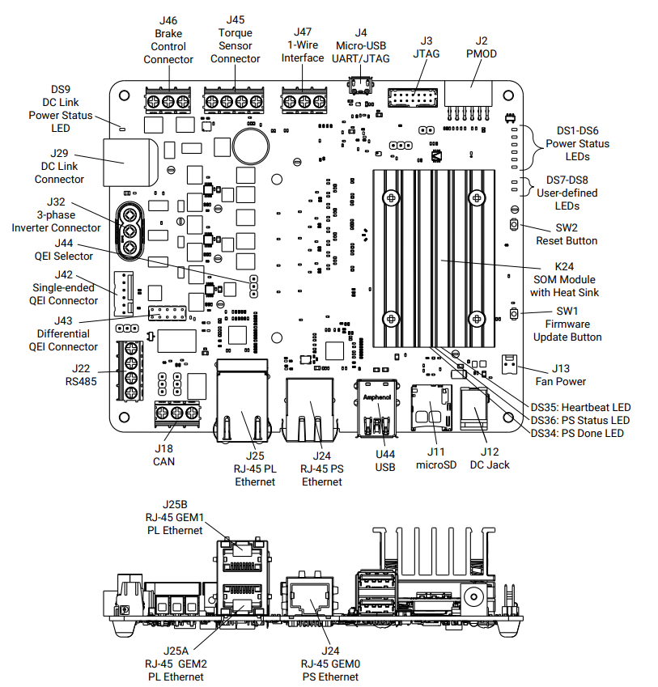

* Connect the USB cable from the host machine to the J4 UART/JTAG interface on the board.

  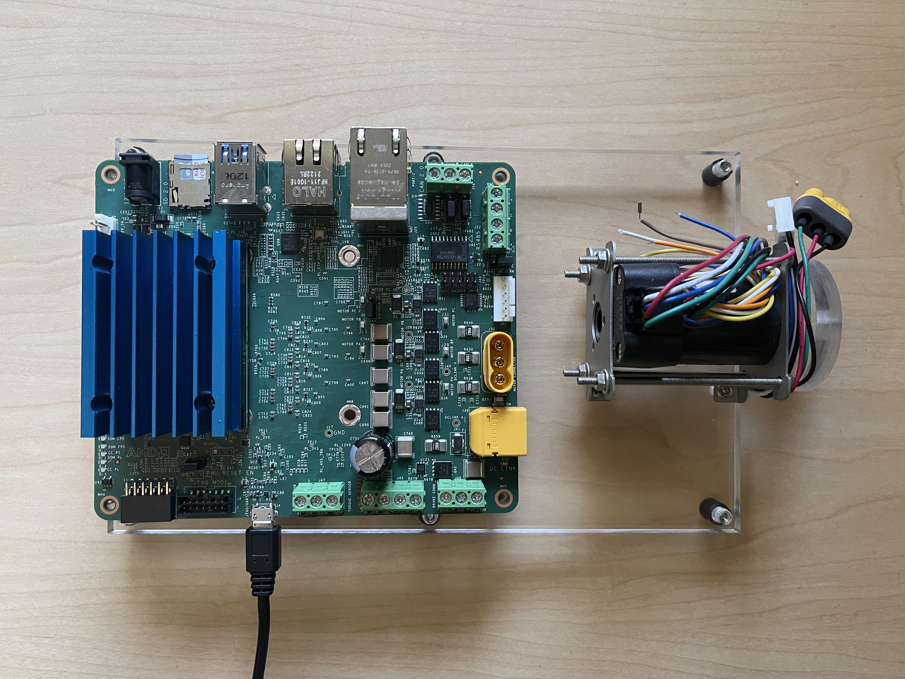

* Connect the Ethernet cable from J24 to your local network with DHCP enabled to install the Linux packages.

  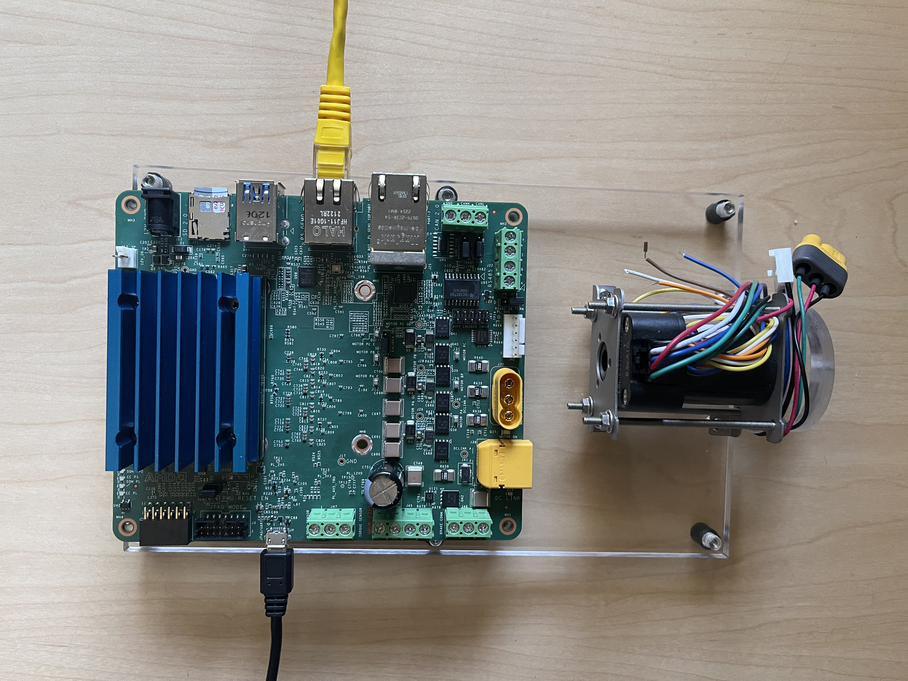

* Connect a 12V power supply to the J12 DC jack.

  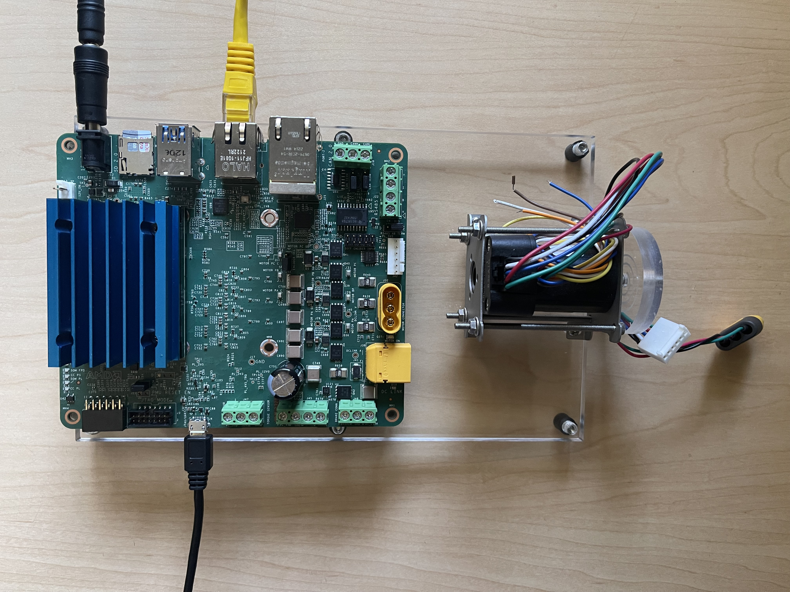

* Connect a 24V power supply to the J29 DC link connector.

  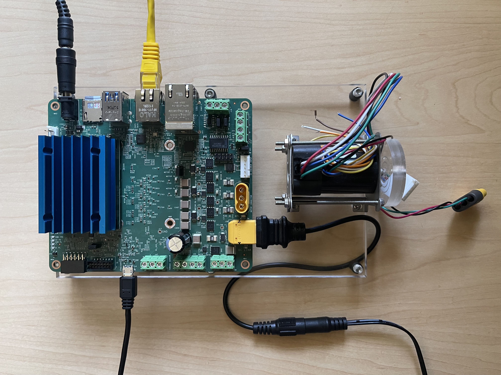

* Connect the encoder header pins to the J42 QEI connector. Ensure J44 is in the "SE" selection.

  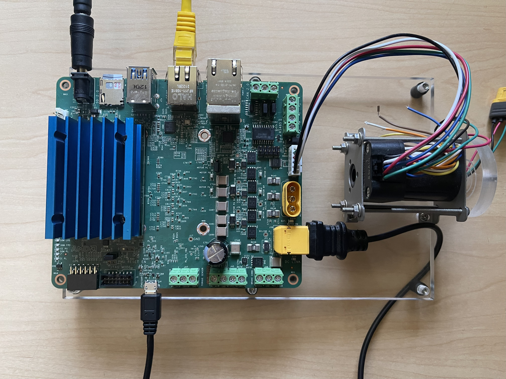

* Connect the motor input to a J32 3-phase inverter connector.

  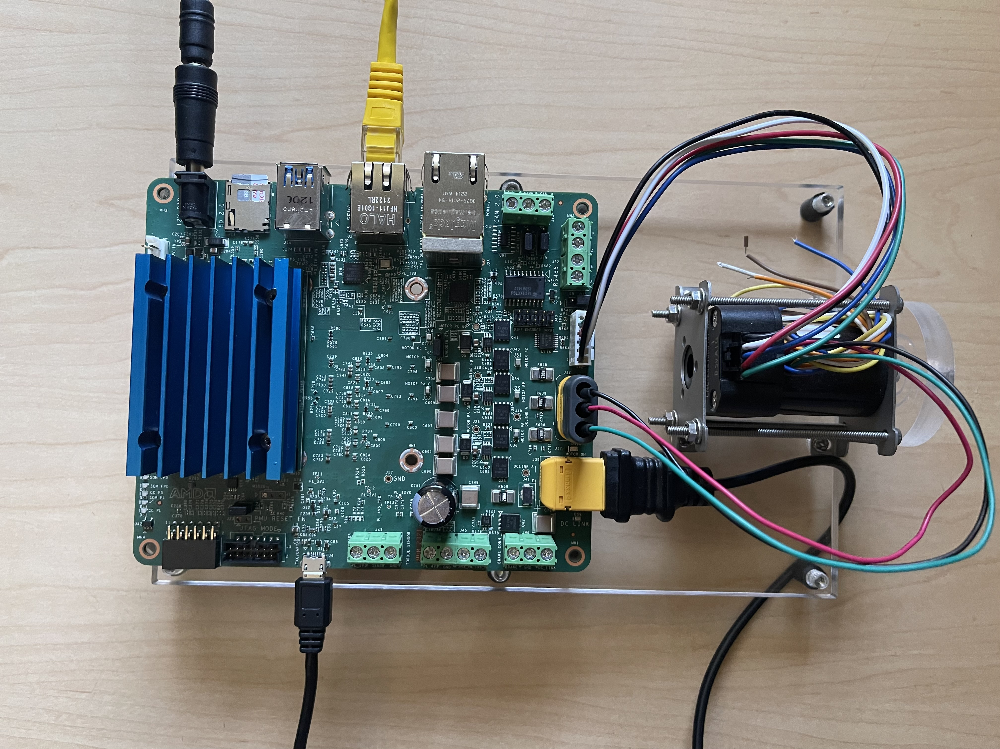

* Connect the One Wire Temperature Sensor to J47 Temp Sensor connector. Red connects to 3-5V, Blue/Black
connects to ground and Yellow/White is Sense(data)

  

* Only for CANopen server interface: Connect PMOD-CAN module to PMOD3 on the
  KR260. Connect CAN cables from J18 on the KD240 to the PMOD-CAN module (CANL
  to CANL, CANH to CANH, GND to GND).

  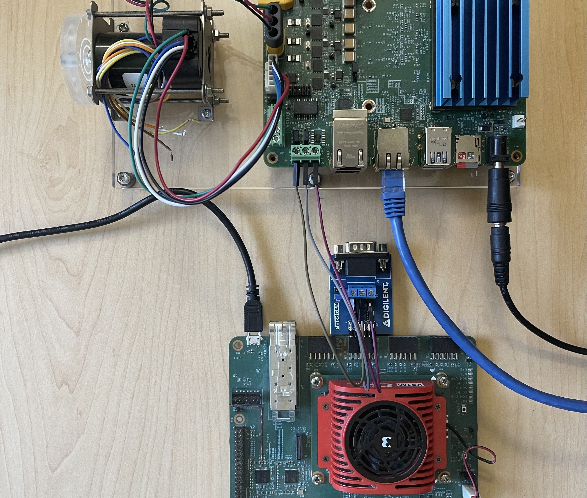

### Docker Image Contents

Starting with the **v0.6 release**, the application is deployed using a Docker-based workflow. Application dependencies and validated software components are packaged within the Docker image, eliminating the need to download and install individual application artifacts separately.

The Docker image has been validated with the following platform and application components.

**_KD240 Platform Artifacts_**

| Components                           | Versions                    |
| ------------------------------------ | --------------------------- |
| AMD EDF                              | 26.1                        |
| Linux Kernel                         | 6.18.10-xilinx              |
| K24 Boot Firmware                    | BOOT-k24-smk-sdt-1.05.bin   |
| xlnx-firmware-kd240-motor-ctrl-qei   | 1.2                         |

**_KR260 Platform Artifacts_**

| Components                           | Versions                    |
| ------------------------------------ | --------------------------- |
| AMD EDF                              | 26.1                        |
| Linux Kernel                         | 6.18.10-xilinx              |
| K26 Boot Firmware                    | BOOT-k26-smk-sdt-1.06.bin   |
| xlnx-firmware-kr260-tsn-rs485pmod    | 1.2                         |

To obtain the latest Linux image and boot firmware, refer to the [Kria Wiki](https://xilinx-wiki.atlassian.net/wiki/spaces/A/pages/1641152513/Kria+K26+SOM#Boot-Firmware-Updates).

**_Application artifacts_**

| Application Package            | EDF versions |
| ------------------------------ | ------------ |
| xlnx-app-kd240-foc-motor-ctrl  | 0.6          |


#### Repositories Information

| Repository                                                                                             | Release Tag                   |
| ------------------------------------------------------------------------------------------------------ | ----------------------------- |
| [Kria SOM Vitis Platforms and Overlays](https://github.com/Xilinx/kria-vitis-platforms)                | [v2.0](https://github.com/Xilinx/kria-vitis-platforms/releases/tag/<placeholder_v2.0>)        |
| [Kria FOC Motor Control App](https://github.com/Xilinx/foc-motor-ctrl)                                 | [v0.6](https://github.com/Xilinx/foc-motor-ctrl/tree/<placeholder_v0.6>)        |
| [Kernel drivers for the FOC Motor Control App](https://github.com/Xilinx/motor-control-iio-modules)    | [v0.3](https://github.com/Xilinx/motor-control-iio-modules/releases/tag/<placeholder_v0.3>)        |


### Initial Setup

1. Go through [Booting Kria Starter Kit Linux](https://xilinx.github.io/kria-apps-docs/kd240/linux_boot.html) to complete the minimum setup required to boot Linux before continuing with instructions on this page.

2. Pull the docker image from dockerhub.

    ```bash
    docker pull xilinx/foc-motor-ctrl-server:latest
    ```
    The storage volume on the SD card can be limited with multiple docker
    images installed. If there are space issues, use the following command
    to remove existing docker images.

    ```bash
    docker rmi --force <image>
    ```

    You can find the images installed with the following command:

    ```bash
    docker images
    ```

3. Install the firmware blob using `dfx-fw-install` through the container.

    ```bash
    FW_NAME=kd240-motor-ctrl-qei

    sudo mkdir -p /lib/firmware/xilinx/${FW_NAME}

    docker run --rm \
     -v /lib/firmware/xilinx/${FW_NAME}:/opt/firmware/xilinx/${FW_NAME} \
     xilinx/foc-motor-ctrl-server:latest sh -c "
     dfx-fw-install --fw-name ${FW_NAME}
     "
    ```
      > **Note:** All the application dependencies like `motor-control-iio-modules`, `pybind11`, `libiio-utils` and `bokeh` are installed automatically when the firmware is installed.

## Load the Firmware

1. Start the Application Container on KD240 host.

    ```bash
    docker run --rm -it --privileged \
    --net=host \
    -v /dev:/dev \
    -v /sys:/sys \
    -v /var/run/dfx-mgrd.socket:/var/run/dfx-mgrd.socket \
    -v /run:/run \
    xilinx/foc-motor-ctrl-server:latest \
    /bin/bash
    ```

2. Load Application Firmware.

    After launching the Docker container, load the required kernel modules and application firmware using `dfx-mgr-client`.

    * Verify Available Firmware Packages

    Set the target firmware name, load the required modules, and verify that the firmware package is available.

    ```bash
    FW_NAME=kd240-motor-ctrl-qei

    # Load required modules for the selected firmware
    kria-modules-load --fw-name ${FW_NAME}

    # List available firmware packages
    dfx-mgr-client -listPackage
    ```

    The output should include the `${FW_NAME}` firmware package.

   * Load the Firmware

   If another firmware package is currently active, unload it before loading the target firmware.

    ```bash
    # Unload the currently active firmware package
    # Replace <id> with the package ID reported by dfx-mgr-client
    dfx-mgr-client -unload <id>

    # Load the target firmware package
    dfx-mgr-client -loadByName ${FW_NAME}
    ```

    After the load operation completes successfully, the accelerator is ready for application execution.

## Control Interfaces

This application provides two interfaces to control the motor. The dashboard
application allows the user to control the motor and view live plots via a
web-based dashboard running on the KD240. The CANopen application allows the
user to start a CANopen server on the KD240 and control the motor via service
calls from another device over the CAN bus. The steps for both control
interfaces are described in more detail below.

Note: Only one interface can used at a time.

## Run the Motor Control Dashboard Application

Complete [Initial Setup](#initial-setup) and [Load the Firmware](#load-the-firmware) first. Then start the dashboard on the KD240 and open it from a host PC:

1. [Start the Dashboard on the KD240](#start-the-dashboard-on-the-kd240).
2. [Access the Dashboard from the Host PC](#access-the-dashboard-from-the-host-pc).

### Start the Dashboard on the KD240

* Run the bokeh server:

  ```bash
  # Run the application to launch bokeh server for the dashboard
  start_motor_dashboard
  ```

  Sample output of the terminal on launching the motor dashboard.

  ```bash
  bash-5.2# start_motor_dashboard
  Checking firmware status...
  Firmware kd240-motor-ctrl-qei is loaded
  To access the Application, open http://192.168.4.89:3006 in the host machine browser.
  Starting Bokeh server
  2026-06-16 22:44:51,597 Starting Bokeh server version 3.5.1 (running on Tornado 6.4.2)
  2026-06-16 22:44:51,606 User authentication hooks NOT provided (default user enabled)
  2026-06-16 22:44:51,627 Bokeh app running at: http://localhost:3006/dashboard
  2026-06-16 22:44:51,628 Starting Bokeh server with process id: 1920
  Using uio device uio0 for motor contorl
  Map uio physical address: 0x00000000a0020000
  Map uio size: 0x0000000000001000
  2026-06-16 22:44:58,395 WebSocket connection opened
  2026-06-16 22:44:58,397 ServerConnection created
  ```

  The following commands can be used to directly launch the Bokeh server without using the helper script:

  ```bash
  # Extract IP address of the ethernet port
  IP_ADDR=$(ip -4 addr show end0 | awk '/inet / {print $2}' | cut -d/ -f1)

  bokeh serve --port 3006 \
      --allow-websocket-origin=${IP_ADDR}:3006 \
      /usr/share/foc-motor-ctrl/dashboard
  ```
    >**NOTE:** To terminate the Bokeh server, use the command `sudo killall bokeh`.

* Change Motor Configurations:

  By default the motor configuration parameters are provided by `/etc/motor-control/config` file.
  The configuration file stores various parameters required for motor control. These parameters include general
  motor settings, voltage and mode configurations, PWM settings, gain parameters, and other calibration settings.
  This allows for flexible and precise configuration of different motors by simply adjusting these parameters in
  the config file. One can point to a different configuration file by passing additional argument to the bokeh server
  allowing to use different configuration files for different motors.

  To run the Bokeh server with a specific configuration file, use the following command structure:
    ```bash
    sudo bokeh serve --port 3006 --show --allow-websocket-origin=<ip>:3006 mc_bokeh.py --args </path/to/config/file>
    ```
  Replace <ip> with board `ip` and `<path/to/config/file>` with the actual path to the desired configuration file.

  > Note: If no path is specified, the default configuration file [anaheim.config](https://github.com/Xilinx/foc-motor-ctrl/blob/main/lib/configs/anaheim.config) will be used. Inline comments in the config file explains each parameter.

### Access the Dashboard from the Host PC

* Open &lt;ip&gt;:3006 in a web browser.

  >**NOTE:** Once the server is running, it retains its settings no matter how many times the browser is closed, opened, or refreshed.

* The system is set to OFF mode/state on starting the dashboard, observe the blue LED DS10 is off.
* If the unit is plugged into a network with DHCP, an IP will be assigned automatically. If not on a network, then configure a static IP. For help on setting up static IP, see [Setting up a private network](https://github.com/Xilinx/vck190-base-trd/blob/2022.1/docs/source/run/run-dashboard.rst#setting-up-a-private-network).

>**NOTE:** The open-loop mode of motor operation is a test mode intended for users with motor control knowledge and experience. Incorrect configurations of values of Vd and Vq can cause the motor to spin at speeds higher than its rating and potentially cause excessive motor heating. Use caution when using the open-loop mode.

### Dashboard Features

* The Mode drop-down is used to select the control system mode of operation.
* The Sample Size text box is used to indicate how many samples are collected and plotted on the graphs for each type of data. The samples are collected at 100 microsecond intervals. The maximum number of samples is limited to 3000 due to dashboard performance limitations. For a large number of samples, there might be a small delay before a dashboard command takes effect.
* The Refresh Interval text box is used to indicate how often the dashboard plots will refresh. A minimum refresh interval will be enforced based on the current sample size (a larger sample size requires a larger refresh interval).
* The gain text boxes are used to adjust the proportional and integral gains of the corresponding control loop.
* The Speed Setpoint text box is used to set the speed setpoint when running the motor in speed mode. The valid range of speed setpoints is -10000 to 10000 rpm.
* The Torque Setpoint text box is used to set the torque setpoint when running the motor in torque mode. The valid range of torque setpoints is -2.5 to 2.5 amps.
* The Open Loop - Vd text box is used to set the  direct voltage (Vd). The valid range for Vd is -24 to 24 volts.
  >**NOTE:** Normally this should be set to ~0V.
* The Open Loop - Vq text box is used to set the quadrature voltage (Vq). The valid range for Vq is -24 to 24 volts.
* The Fault Status indicators show if any faults have occured. When a critical fault occurs, the corresponding indicator will turn red. For a warning level faults, the corresponding indicator will turn yellow.
* The Clear Faults button is used to clear all faults and put the system into Off mode.
* The Electrical Data plot shows the currents and voltages for Phase A, B, and C. The voltage lines are hidden by default. The visibility of each current and voltage line can be toggled by clicking the legend labels. The current axis is shown on the left if any current lines are visible, and the voltage axis is shown on the right is any voltage lines are visible.
* The Mechanical Data plot shows the speed and position of the motor. The visibility of each line can be toggled by clicking on the legend labels. The speed axis is shown on the left is speed is visible and the position axis is shown on the right if position is visible.
* The Live Analysis plot shows the data that is selected for each axis using the buttons on the right.

When the dashboard is first launched, the system will be in Off mode, and the dashboard will look similar to the following image. Observe that the electrical readings are near zero.

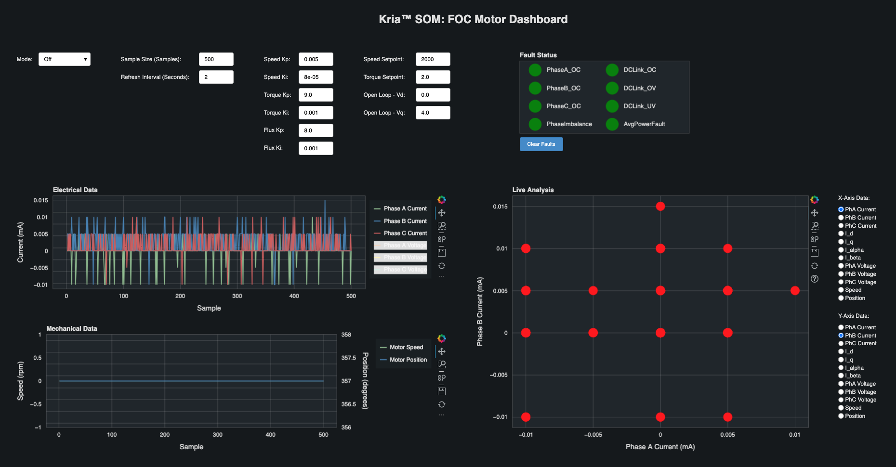

To run the application in Speed mode, select **Speed** from the Mode drop-down, and use the Speed Setpoint text box to enter a speed setpoint. The following image shows the motor running in speed mode with a speed setpoint of 2000 rpm and the load disk that is included in the Motor Accessory Kit.

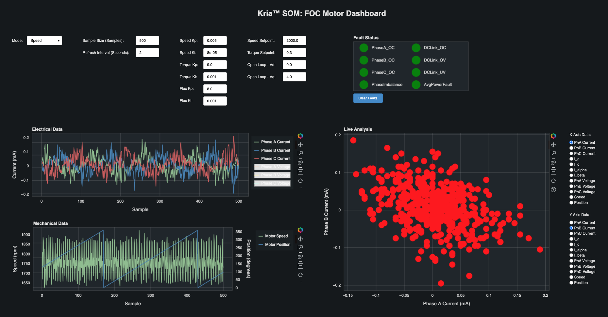

To run the application in Torque mode, select **Torque** from the Mode drop-down and use the Torque Setpoint text box to enter a torque setpoint. The following image shows the motor running in torque mode with a torque setpoint of 1 amp and the load disk that is included in the Motor Accessory Kit.

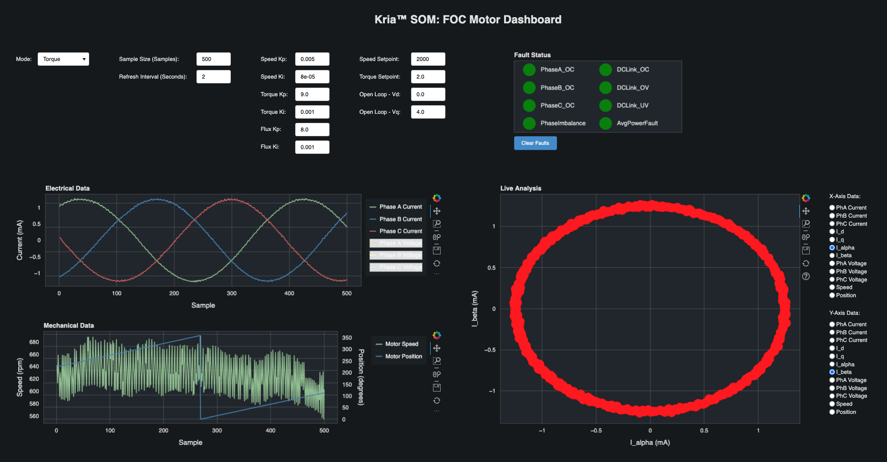

To run the application in Open Loop mode, select **Open Loop** from the Mode drop-down, and use the Vd/Vq text boxes to set Vd/Vq. The following image shows the motor running in open loop mode with Vd set to 0, Vq set to 4 volts, and the load disk that is included in the Motor Accessory Kit.

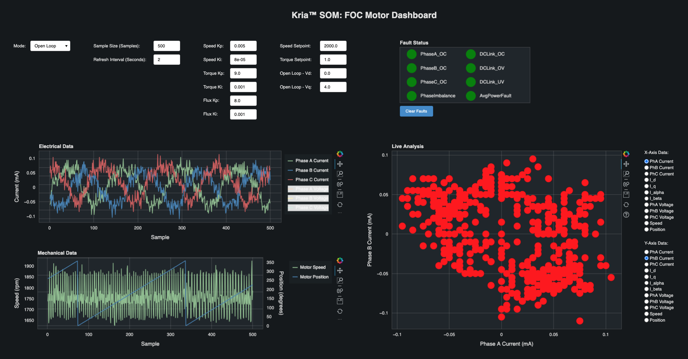

The following images show what the dashboard looks like when a larger load is applied to the motor. As the load on the motor increases, the currents will increase and the I_alpha/I_beta circle will expand.

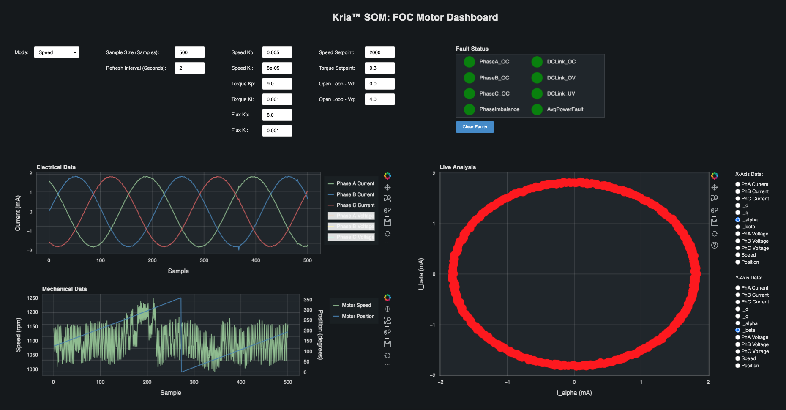

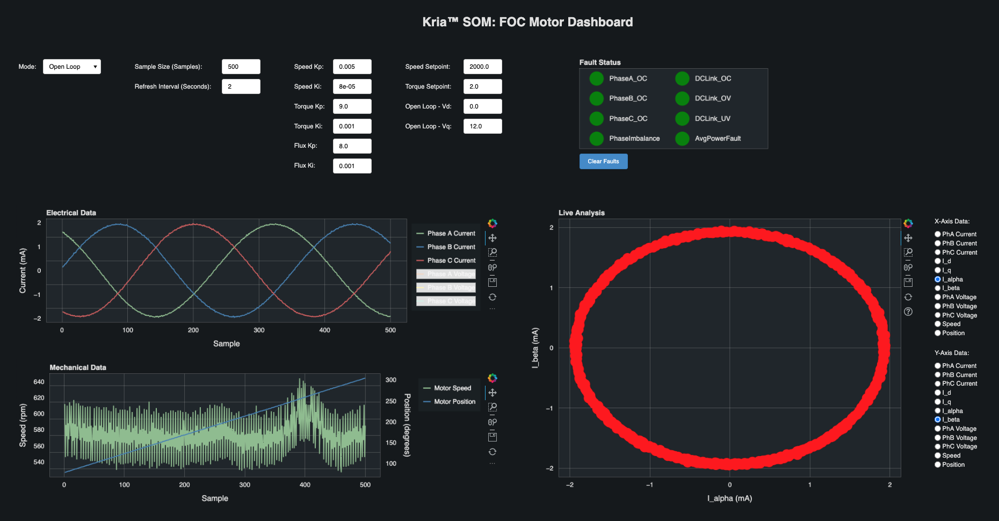

## Run the Motor Control ROS2 CANopen Application

Starting with the **v0.6 release**, this app runs inside Docker containers on
both boards: the CANopen server container on the KD240 and the ROS2 CANopen
host container on the KR260.

| Board | Docker image                               |
| ----- | ------------------------------------------ |
| KD240 | `xilinx/foc-motor-ctrl-server:latest`      |
| KR260 | `xilinx/foc-motor-ctrl-ros2-canopen:latest`|

Complete the setup on both boards first, then verify CAN communication
between them, and finally start the server and the host tests:

1. [Set Up the KD240](#set-up-the-kd240)
2. [Set Up the KR260](#set-up-the-kr260)
3. [Test CAN Communication](#test-can-communication)
4. [Run the CANopen Server on the KD240](#run-the-canopen-server-on-the-kd240)
5. [Run the CANopen Host Tests on the KR260](#run-the-canopen-host-tests-on-the-kr260)

### Set Up the KD240

* Pull the CANopen server docker image on the KD240.

  ```bash
  docker pull xilinx/foc-motor-ctrl-server:latest
  ```

* Launch the docker container on the KD240.

  ```bash
  docker run --rm -it --privileged \
  --net=host \
  -v /dev:/dev \
  -v /sys:/sys \
  -v /var/run/dfx-mgrd.socket:/var/run/dfx-mgrd.socket \
  -v /run:/run \
  xilinx/foc-motor-ctrl-server:latest \
  /bin/bash
  ```

* Bring up the CAN interface from inside the KD240 container.

  ```bash
  ip link set can0 up type can bitrate 100000
  ip link set can0 txqueuelen 10000
  ip link set can0 up
  ```

### Set Up the KR260

* On the KR260, go through [Booting Kria Starter Kit Linux](https://xilinx.github.io/kria-apps-docs/kr260/build/html/docs/linux_boot.html) to complete the minimum setup required to boot Linux before continuing with instructions on this page.

* Pull the ROS2 CANopen host docker image on the KR260.

  ```bash
  docker pull xilinx/foc-motor-ctrl-ros2-canopen:latest
  ```

* Install the firmware blob on the KR260 using `dfx-fw-install` through the
  container. The kr260-tsn-rs485pmod firmware is used to enable the PMOD-CAN
  interface on the KR260.

  ```bash
  FW_NAME=kr260-tsn-rs485pmod

  sudo mkdir -p /lib/firmware/xilinx/${FW_NAME}

  docker run --rm \
   -v /lib/firmware/xilinx/${FW_NAME}:/opt/firmware/xilinx/${FW_NAME} \
   xilinx/foc-motor-ctrl-ros2-canopen:latest sh -c "
   dfx-fw-install --fw-name ${FW_NAME}
   "
  ```

* Launch the docker container on the KR260.

  ```bash
  docker run --rm -it --privileged \
      --net=host \
      --name=motor_control \
      -v /dev:/dev \
      -v /sys:/sys \
      -v /var/run/dfx-mgrd.socket:/var/run/dfx-mgrd.socket \
      -v /run:/run \
      xilinx/foc-motor-ctrl-ros2-canopen:latest bash
  ```

* Source the ROS2 environment in the container. This has to be repeated in
  every container session before running any `ros2` command.

  ```bash
  source /opt/ros/jazzy/setup.sh
  ```

* Load the kr260-tsn-rs485pmod firmware from inside the KR260 container.

  ```bash
  FW_NAME=kr260-tsn-rs485pmod

  # Load required modules for the selected firmware
  kria-modules-load --fw-name ${FW_NAME}

  # List available firmware packages
  dfx-mgr-client -listPackage

  # Unload the currently active firmware package, if any
  # Replace <id> with the package ID reported by dfx-mgr-client
  dfx-mgr-client -unload <id>

  # Load the target firmware package
  dfx-mgr-client -loadByName ${FW_NAME}
  ```

* Bring up the CAN interface from inside the KR260 container.

  ```bash
  ip link set can0 up type can bitrate 100000
  ip link set can0 txqueuelen 10000
  ip link set can0 up
  ```

### Test CAN Communication

The `can-utils` tools are included in both docker images, so run the following
checks from inside the container on each board.

* Verify the CAN interface state on both boards.

  ```bash
  ip -d -s link show can0
  ```

* On one board, run candump.

  ```bash
  candump can0
  ```

* On the other board, use cansend to send test data. You should see this data
  show up on the board running candump.

  ```bash
  cansend can0 123#1122334455667788
  ```

### Run the CANopen Server on the KD240

* In the KD240 container, run the CANopen application.

  > **Note**: The kd240-motor-ctrl-qei firmware must be loaded before starting
  the server. Refer to [Load the Firmware](#load-the-firmware).

  ```bash
  start_motor_control --canopen-server
  ```

* To terminate the server, kill the fmc_canopen application

  ```bash
  killall fmc_canopen
  ```

### Run the CANopen Host Tests on the KR260

* Run the CANopen host tests from the KR260 container launched in
  [Set Up the KR260 (CANopen Master)](#set-up-the-kr260-canopen-master), using
  the launch file described in the following subsections. There are 2 tests:

  * *Simple CiA402 system*: where host accesses motor directly using ros2_canopen 402 driver.
  * *ROS2 Control example*: where host accesses motor over ros2_control interface.

  > **Note**: Do not run both the launch files together as they will interfere in the operations. Only one test can be running at a given time.

#### Run a simple CiA402 system host

* In the docker run terminal start the canopen 402 host ros container using the launch file

  ```bash
  ros2 launch kria_motor_control kd240.system.launch.py
  ```
  > **Reminder**: Ensure that the motor server on the KD240 is running before executing the script on the KR260.

* Open a new terminal, start another session of the the same container and
  source the ROS2 environment.

  ```bash
  docker exec -it motor_control bash
  source /opt/ros/jazzy/setup.sh
  ```

* Check the available services and their types.

  ```bash
  ros2 service list -t
  ```

  The output should look similar to this:

  ```bash
  ubuntu@KR260:~$ ros2 service list -t
  /device_container_node/change_state [lifecycle_msgs/srv/ChangeState]
  /device_container_node/describe_parameters [rcl_interfaces/srv/DescribeParameters]
  /device_container_node/get_parameter_types [rcl_interfaces/srv/GetParameterTypes]
  /device_container_node/get_parameters [rcl_interfaces/srv/GetParameters]
  /device_container_node/init_driver [canopen_interfaces/srv/CONode]
  /device_container_node/list_parameters [rcl_interfaces/srv/ListParameters]
  /device_container_node/set_parameters [rcl_interfaces/srv/SetParameters]
  /device_container_node/set_parameters_atomically [rcl_interfaces/srv/SetParametersAtomically]
  /kd240/cyclic_position_mode [std_srvs/srv/Trigger]
  /kd240/cyclic_velocity_mode [std_srvs/srv/Trigger]
  /kd240/describe_parameters [rcl_interfaces/srv/DescribeParameters]
  /kd240/get_parameter_types [rcl_interfaces/srv/GetParameterTypes]
  /kd240/get_parameters [rcl_interfaces/srv/GetParameters]
  /kd240/halt [std_srvs/srv/Trigger]
  /kd240/init [std_srvs/srv/Trigger]
  /kd240/interpolated_position_mode [std_srvs/srv/Trigger]
  /kd240/list_parameters [rcl_interfaces/srv/ListParameters]
  /kd240/nmt_reset_node [std_srvs/srv/Trigger]
  /kd240/nmt_start_node [std_srvs/srv/Trigger]
  /kd240/position_mode [std_srvs/srv/Trigger]
  /kd240/recover [std_srvs/srv/Trigger]
  /kd240/sdo_read [canopen_interfaces/srv/CORead]
  /kd240/sdo_write [canopen_interfaces/srv/COWrite]
  /kd240/set_parameters [rcl_interfaces/srv/SetParameters]
  /kd240/set_parameters_atomically [rcl_interfaces/srv/SetParametersAtomically]
  /kd240/target [canopen_interfaces/srv/COTargetDouble]
  /kd240/torque_mode [std_srvs/srv/Trigger]
  /kd240/velocity_mode [std_srvs/srv/Trigger]
  /launch_ros_33646/describe_parameters [rcl_interfaces/srv/DescribeParameters]
  /launch_ros_33646/get_parameter_types [rcl_interfaces/srv/GetParameterTypes]
  /launch_ros_33646/get_parameters [rcl_interfaces/srv/GetParameters]
  /launch_ros_33646/list_parameters [rcl_interfaces/srv/ListParameters]
  /launch_ros_33646/set_parameters [rcl_interfaces/srv/SetParameters]
  /launch_ros_33646/set_parameters_atomically [rcl_interfaces/srv/SetParametersAtomically]
  /master/describe_parameters [rcl_interfaces/srv/DescribeParameters]
  /master/get_parameter_types [rcl_interfaces/srv/GetParameterTypes]
  /master/get_parameters [rcl_interfaces/srv/GetParameters]
  /master/list_parameters [rcl_interfaces/srv/ListParameters]
  /master/sdo_read [canopen_interfaces/srv/COReadID]
  /master/sdo_write [canopen_interfaces/srv/COWriteID]
  /master/set_parameters [rcl_interfaces/srv/SetParameters]
  /master/set_parameters_atomically [rcl_interfaces/srv/SetParametersAtomically]
  ```

* To view an interface definition, use:

  ```bash
  ros2 interface show <type>
  ```

  For example, to view the interface definition for the canopen_interfaces/srv/COTargetDouble
  type which is used for the /kd240/target service, run the command below.
  This will print the input (target) and output (success).

  ```bash
  ubuntu@KR260:~$ ros2 interface show canopen_interfaces/srv/COTargetDouble
  float64 target
  ---
  bool success
  ```

* Use service calls to control the motor.

  The services available and their descriptions can be found in the
  [Cia402 Driver documentation](https://ros-industrial.github.io/ros2_canopen/manual/humble/user-guide/cia402-driver.html).

  Reset:

  ```bash
  ros2 service call /kd240/nmt_reset_node std_srvs/srv/Trigger
  ```

  Init:

  ```bash
  ros2 service call /kd240/init std_srvs/srv/Trigger
  ```

  Change to velocity mode:

  ```bash
  ros2 service call /kd240/velocity_mode std_srvs/srv/Trigger
  ```

  Change target speed:

  ```bash
  ros2 service call /kd240/target canopen_interfaces/srv/COTargetDouble "target: 3000"
  ```

  > **Note**: For the Anaheim motor kit, the speed range is 250 to 10000 rpm in
  both directions. If the motor does not spin at 250 rpm, try a faster speed.
  The minimum speed can vary by motor.

#### Run a ROS2 Control based example

* Reset the Pmod CAN interface using the following commands on KR260 board:

  ```bash
  sudo ip link set can0 down
  sudo ip link set can0 up
  ```

* In the docker run terminal start the canopen 402 control system host using the launch file

  ```bash
  ros2 launch kria_motor_control kd240.ros2_control.launch.py
  ```
  > **Reminder**: Ensure that the motor server on the KD240 is running before executing the script on the KR260.

* Open a new terminal, start another session of the the same container and
  source the ROS2 environment.

  ```bash
  docker exec -it motor_control bash
  source /opt/ros/jazzy/setup.sh
  ```

* List the available controllers using ros2 control cli utility

  ```bash
  ros2 control list_controllers
  ```

  The output should look similar to this:

  ```bash
  ubuntu@KR260:~$ ros2 control list_controllers
  forward_velocity_controller[velocity_controllers/JointGroupVelocityController] active
  joint_state_broadcaster[joint_state_broadcaster/JointStateBroadcaster] active
  ```

* To view the available hardware interfaces, use:

  ```bash
  ros2 control list_hardware_interfaces
  ```

  The output should look similar to this:
  ```bash
  ubuntu@KR260:~$ ros2 control list_hardware_interfaces
  command interfaces
          wheel_joint/velocity [available] [claimed]
  state interfaces
          wheel_joint/position
          wheel_joint/velocity
  ```

* List the Ros2 Topics

  ```bash
  ubuntu@KR260:~$ ros2 topic list
  /dynamic_joint_states
  /forward_velocity_controller/commands
  /forward_velocity_controller/transition_event
  /joint_state_broadcaster/transition_event
  /joint_states
  /kd240_wheel/joint_states
  /kd240_wheel/nmt_state
  /kd240_wheel/rpdo
  /kd240_wheel/tpdo
  /parameter_events
  /robot_description
  /rosout
  /tf
  /tf_static
  ```

* Observe the live state of the system using dynamic_joint_states

  ```bash
  ros2 topic echo  /dynamic_joint_states
  ```

  This continuously updates the current state of the system and shows the position and speed of the motor.


* Open a new terminal, start another session of the the same container and
  source the ROS2 environment.

  ```bash
  docker exec -it motor_control bash
  source /opt/ros/jazzy/setup.sh
  ```

* Update the speed of the motor using velocity controller in a new terminal

  ```bash
  ros2 topic pub --once /forward_velocity_controller/commands std_msgs/msg/Float64MultiArray "data: [5000]"
  ```

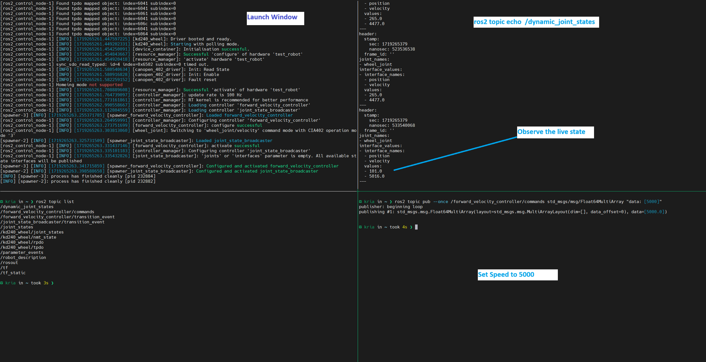

## Run One Wire Temperature Sensor Demo

* In this demo, the lm-sensors utility probes the One Wire Temperature sensor, reads and displays the captured temperature value on  the serial terminal.

* Ensure to load the motor-ctrl-qei firmware before running the demo

   If another firmware package is currently active, unload it before loading the target firmware.

    ```bash
    # Unload the currently active firmware package
    # Replace <id> with the package ID reported by dfx-mgr-client
    dfx-mgr-client -unload <id>

    # Load the target firmware package
    dfx-mgr-client -loadByName ${FW_NAME}
    ```

* You can check if the slave entry is added under `/sys/bus/w1/devices` and if master bus also registers this slave.

  ```bash
  bash-5.2# cd /sys/bus/w1/devices/
  bash-5.2# ls
  28-00000f051201  w1_bus_master1
  bash-5.2# cat 28-00000f051201/name
  28-00000f051201
  bash-5.2# ls 28-00000f051201
  alarms  conv_time  driver  eeprom_cmd  ext_power  features  hwmon  id  name  power  resolution  subsystem  temperature  uevent  w1_slave
  bash-5.2# cd w1_bus_master1
  bash-5.2# cat w1_master_slave_count
  1
  bash-5.2# cat w1_master_slaves
  28-00000f051201
  ```

* You can also read the temperature through the filesystem

  ```bash
  bash-5.2# cd /sys/class/hwmon/
  bash-5.2# ls
  hwmon0  hwmon1  hwmon2  hwmon3
  bash-5.2# cat hwmon3/name
  w1_slave_temp
  bash-5.2# cat hwmon3/temp1_input
  21250
  ```

* The sensor read through the filesystem provides temperature in millidegrees Celsius

* The `lm_sensors` utility's `sensors` command gathers information from the kernel interfaces provided by `hwmon` subsystem, aggregates this raw data,
applies scaling and calibration and presents it in a human-readable format.

* Run the 1-wire demo to measure temperature.

  ```bash
  # Output should be the following

  bash-5.2# sensors
  ina260-i2c-1-40
  Adapter: Cadence I2C at ff030000
  in0:         1000.00 uV (crit min =  +0.00 V, crit max =  +0.00 V)
  in1:           5.07 V  (crit min =  +0.00 V, crit max =  +0.00 V)
  power1:        2.55 W  (crit =   0.00 W)
  curr1:       504.00 mA (crit min =  +0.00 A, crit max =  +0.00 A)

  w1_slave_temp-virtual-0
  Adapter: Virtual device
  temp1:        +21.2 C

  ams-isa-0000
  Adapter: ISA adapter
  VCC_PSPLL:         1.20 V
  VCC_PSBATT:        0.00 V
  VCCINT:          718.00 mV
  VCCBRAM:         848.00 mV
  VCCAUX:            1.80 V
  VCC_PSDDR_PLL:     1.79 V
  VCC_PSINTFP_DDR: 854.00 mV
  VCC_PSINTLP:     847.00 mV
  VCC_PSINTFP:     847.00 mV
  VCC_PSAUX:         1.80 V
  VCC_PSDDR:         1.09 V
  VCC_PSIO3:         1.79 V
  VCC_PSIO0:         1.79 V
  VCC_PSIO1:         1.79 V
  VCC_PSIO2:         1.79 V
  PS_MGTRAVCC:     851.00 mV
  PS_MGTRAVTT:       1.80 V
  VCC_PSADC:         1.79 V
  VCCINT:          717.00 mV
  VCCAUX:            1.80 V
  VREFP:             1.25 V
  VREFN:             0.00 V
  VCCBRAM:         848.00 mV
  VCC_PSINTLP:     846.00 mV
  VCC_PSINTFP:     850.00 mV
  VCC_PSAUX:         1.80 V
  VCCAMS:            1.78 V
  Temp_LPD:         +40.0 C
  Temp_FPD:         +40.1 C
  Temp_PL:          +41.3 C
  ```

* The output will have multiple sensors and `w1_slave_temp-virtual` is the desired One Wire Temperature Sensor value that is connected to KD240.

## Next Steps

* Go back to the [KD240 FOC Motor Control Application Start Page](../foc_motor_control_landing)

<!---

Licensed under the Apache License, Version 2.0 (the "License"); you may not use
this file except in compliance with the License.

You may obtain a copy of the License at http://www.apache.org/licenses/LICENSE-2.0.

Unless required by applicable law or agreed to in writing, software distributed under the License is distributed on an "AS IS" BASIS, WITHOUT WARRANTIES OR CONDITIONS OF ANY KIND, either express or implied. See the License for the specific language governing permissions and limitations under the License.

-->

<p class="sphinxhide" align="center">Copyright&copy; 2023-2025 Advanced Micro Devices, Inc</p>
